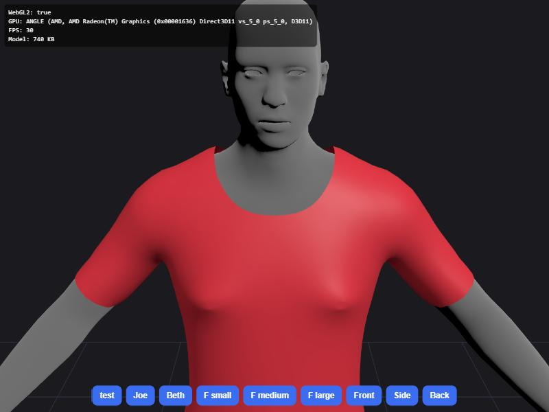
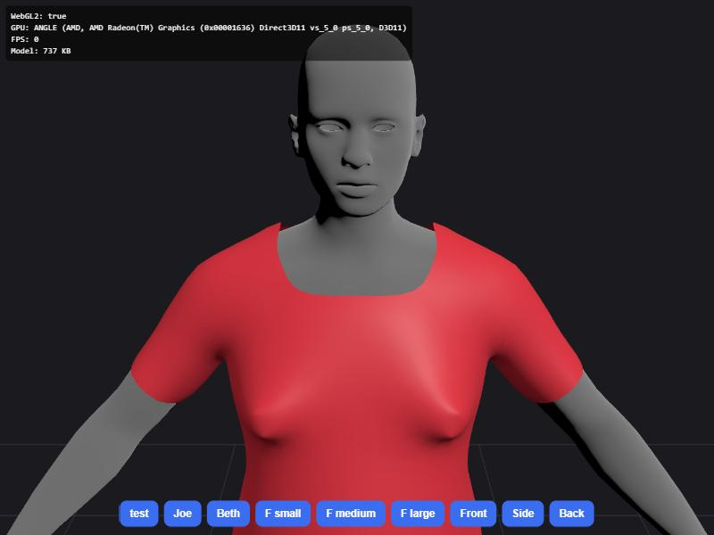

# Task 2 result: stray piece under the chin removed (B24)

Date: 2026-11-15. Task 2 of `2026-11-15-fable-review.md`.

## Result

Every tee is now 1 piece with 4 openings (neck, hem, two sleeves), on all six synthetic bodies, Joe and Beth. Before: 2 pieces and 5 openings on all eight. Two full builds are still byte-identical (`check_repeatable.py`: REPEATABLE for `spike/out` and `private/out`). No other figure in the reports changed.

| Body | Tee faces (area cm²) | Openings (cm) |
| --- | --- | --- |
| synthetic_small | 3896 (7259.6) | 102.9, 67.4, 29.6, 29.6 |
| synthetic_medium | 3900 (8415.6) | 115.3, 69.8, 32.1, 32.1 |
| synthetic_large | 3926 (9914.1) | 125.7, 77.1, 34.4, 34.4 |
| synthetic_female_small | 3666 (5547.8) | 98.2, 65.8, 24.9, 24.9 |
| synthetic_female_medium | 3620 (6534.5) | 109.2, 71.2, 27.7, 27.7 |
| synthetic_female_large | 3640 (7883.4) | 122.1, 73.5, 30.2, 30.2 |

Face counts are the exported GLB's triangles. Produced by `python spike/build_all.py --private --jobs 4`.

Viewer, `?view=neckfront`: nothing under the chin on synthetic_medium or synthetic_female_large.

## Change

`garment.py`, `build_tee`: after the neckline cut, keep the largest connected group of faces and delete the rest. Applies only when a neckline is given, so trousers are unaffected. The review's optional second step (delete any face above the neckline height regardless of its depth) was not needed.

## Not checked

Joe's and Beth's neck views were not looked at by eye here; their reports show 1 piece and 4 openings.
