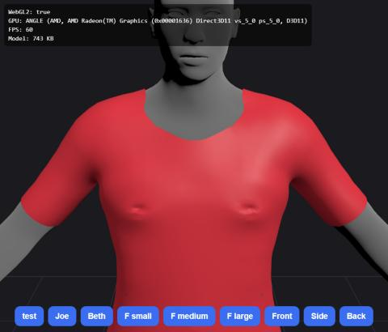
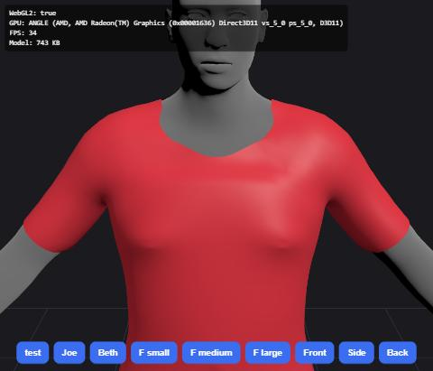
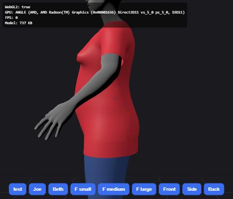
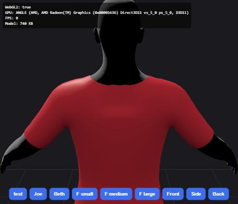
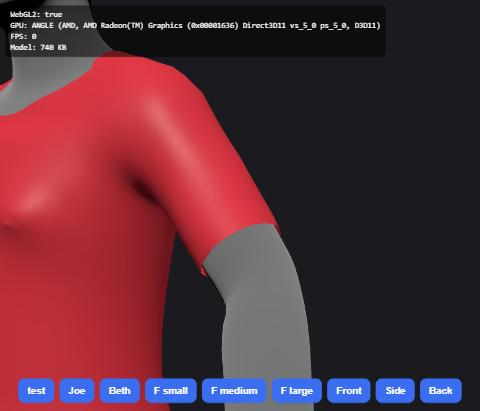

# Task 3 result: floating shoulders fixed (B23)

Date: 2026-11-15. Task 3 of `2026-11-15-fable-review.md`.

## Result

Shoulder gap is now within the limit (0.5 cm worst band mean, 1.0 cm max) on all six synthetic bodies and Joe, and tee chest calibration still converges on all seven. Two full builds are byte-identical. No other check got worse.

| Body | Shoulder gap before, worst band mean / max (cm) | Now | Chest calibration residual (cm) |
| --- | --- | --- | --- |
| synthetic_small | 2.11 / 3.10 | 0.45 / 0.53 | -0.22 |
| synthetic_medium | 1.77 / 2.83 | 0.44 / 0.45 | -0.40 |
| synthetic_large | 1.89 / 2.91 | 0.42 / 0.46 | -0.33 |
| synthetic_female_small | 1.46 / 2.13 | 0.42 / 0.53 | -0.11 |
| synthetic_female_medium | 1.64 / 2.21 | 0.43 / 0.56 | -0.33 |
| synthetic_female_large | 1.80 / 2.55 | 0.44 / 0.56 | -0.21 |
| Joe | 2.96 / 4.25 | 0.37 / 0.45 | -0.25 |

Beth fails at 0.77 / 0.86 cm (was 1.73 / 2.07). She has no garment file, so her tee uses the default 6 mm minimum gap, which the settle cannot go below. That is a missing fixture, not the method.

The limits are now in `spike/tolerances.json` (`tee_shoulder_gap_band_mean_max_cm`, `tee_shoulder_gap_max_cm`) and `check_reports.py` fails on them. They are the task 5 exit numbers Joe accepted.

## Change (`garment.py`, `build_tee`, `settle_shoulders=True` for tees)

Only in the shoulder region: within 10 cm below the shoulder line, and no wider than the shoulder joints plus 3 cm.

1. The ease fades to the minimum gap where the body faces up (full ease at normal z 0.3, minimum gap at 0.8), as the review proposed.
2. After smoothing and the neckline cut, a settle step draws the cloth onto the body at the minimum gap, weighted by how much the body or the cloth faces up. It runs six times, because the normals change as the cloth settles. The neckline edge settles fully, as a crew neck's ribbing lies against the body.

The ease fade alone took synthetic_medium from 1.77 to 1.22 cm: smoothing bridged the hollow again, as the review predicted, so step 2 was needed.

## Rejected first version

Applying the same steps to everything above the chest landmark passed the shoulder limit but made the tee cling to the chest and bust (median tee clearance on synthetic_large fell from 1.44 to 0.53 cm, nipples showing through), and added tee-through-trousers intersections (synthetic_large 0 to 9, female large 33 to 38). Limiting it to the shoulder region removed both. Median clearance on synthetic_large is now 1.15 cm.

## Screenshots (current)

## Not done

- Joe's and Beth's shoulders not looked at by eye.
- The bust on synthetic_female_large still shows a point at the nipple. It was already there before this change (see the task 2 screenshot); likely B8, which task 5 should address.
- This is a stopgap on the offset shell. If task 5's cloth simulation lands, it replaces this.
