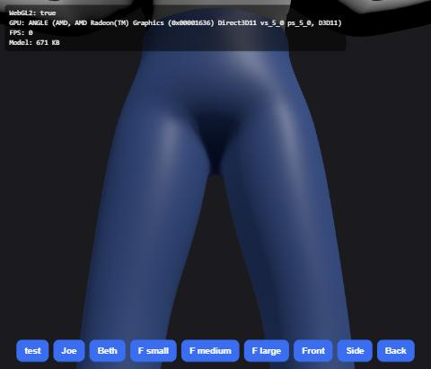
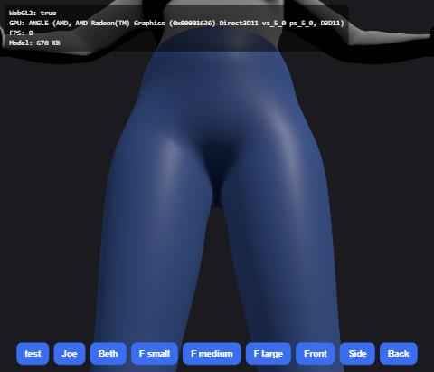
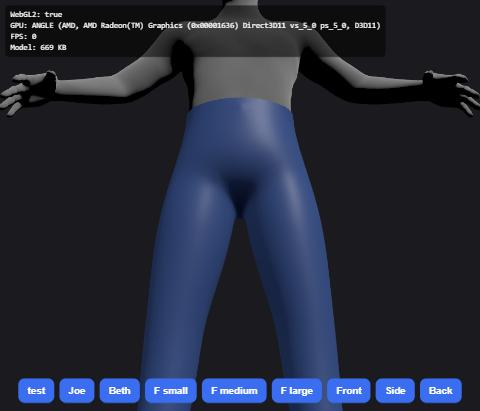

# Task 4 result: trouser legs no longer cross at the crotch (B1)

Date: 2026-11-15. Task 4 of `2026-11-15-fable-review.md`.

## Result

Trouser self-intersections are 0 on all six synthetic bodies and Joe (before: 8 to 38). Calibrations are unchanged to within 0.07 cm, and two full builds are byte-identical. No other check changed.

| Body | Self-intersecting pairs before → now | Calibration residuals before → now (cm: hem, hip, waist) |
| --- | --- | --- |
| synthetic_small | 26 → 0 | 0.03, -0.04, 0.06 → 0.03, -0.04, 0.05 |
| synthetic_medium | 26 → 0 | 0.07, -0.01, 0.30 → 0.07, 0.01, 0.30 |
| synthetic_large | 38 → 0 | 0.00, -1.71, 0.03 → 0.00, -1.64, 0.03 (not converged before either) |
| synthetic_female_small | 8 → 0 | 0.05, -0.11, 0.33 → 0.05, -0.09, 0.32 |
| synthetic_female_medium | 27 → 0 | 0.06, -0.07, 0.32 → 0.06, -0.05, 0.32 |
| synthetic_female_large | 30 → 0 | 0.00, -1.10, 1.78 → 0.00, -1.04, 1.78 (not converged before either) |
| Joe | 33 → 0 | 3.46, 0.00, 0.38 → unchanged (hem not converged, B3) |

Minimum trouser clearance is still 0.28 to 0.30 cm, and no body passes through the trousers on any synthetic body.

## Change (`garment.py`, `build_tee`, `fork_z` for trousers)

Inside `push_out`, below crotch height plus 3 cm, a trouser vertex whose source body vertex is on the left leg is kept at least 1.5 mm left of the centre plane, and likewise on the right. Vertices whose source is within 5 mm of the centre line, or that have no source, are left alone. So the two leg shells end 3 mm apart and cannot cross.

## Still failing

- **Joe's body through trousers: 16 pairs, unchanged.** So they are not at the crotch. The check counts them but does not locate them; finding where they are is the next step.
- The synthetic_large and synthetic_female_large hip calibrations still miss (-1.64 and -1.04 cm), and the female large waist is +1.78 cm. These were already failing and are not caused by this change.
