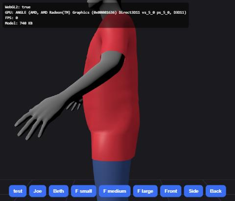
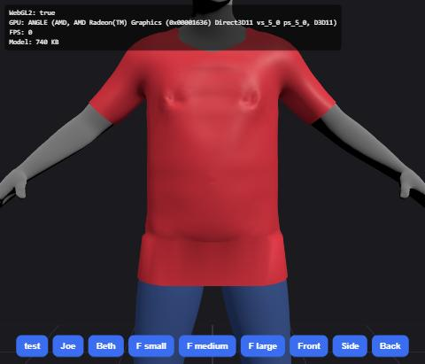
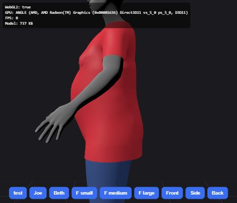
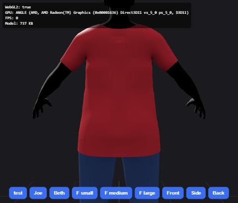

# Task 5 result: tee drape with Blender cloth (B22)

Date: 2026-11-15. Task 5 of `2026-11-15-fable-review.md`; exit numbers agreed in `2026-11-15-joe-accepts-fable-review.md`. Time box 3 hours, started 12:44, stopped at about 13:25.

## Result

The cloth drape fixes the tee's shape. The waist no longer clings (synthetic_medium waist was 14.9 cm short of the garment, now 0.2), and the tee hangs from the chest over the trousers. Every measurable exit number passes on all six synthetic bodies and Joe, except two that are marginal. Three exit items need Joe.

Built with `python spike/build_all.py --private --drape --jobs 4`, twice.

| Exit number | Limit | Synthetic bodies (6) | Joe |
| --- | --- | --- | --- |
| Tee pieces / openings | 1 / 4 | 1 / 4 on all | 1 / 4 |
| Waist circumference vs garment | ±2 cm | -0.4 to -0.1 | no hem figure yet (108.0 against 108 chest) |
| Hem circumference vs garment | ±2 cm | +0.1 to +1.0 | no hem figure yet |
| Body / cloth-to-cloth / tee-through-trousers intersections | 0 | 0 / 0 / 0 on all | 0 / 0 / 0 |
| Shoulder gap, worst band mean / max | 0.5 / 1.0 cm | 0.47 to **0.52** / 0.57 to 0.90 | 0.48 / 0.62 |
| Same result from two builds | (to agree) | max vertex difference 0.00 to 0.56 cm | 0.71 cm |
| Silhouette depth vs Joe's side photo | ±2 cm | n/a | **needs a side photo** |
| Joe says yes by eye, front and side | yes | n/a | **needs Joe** |

Also passing: chest -0.5 to +0.3 cm, length (shoulder to hem) +0.6 to +1.6 cm, sleeve and neckline unchanged. Minimum cloth clearance 0.24 to 0.27 cm. `check_reports.py` now checks the waist and hem circumferences.

### Marginal

- **Shoulder gap**: 0.51 to 0.52 cm worst band mean on synthetic_small, synthetic_large and synthetic_female_medium (limit 0.5). The cloth's collision floor is 3 mm, and it sags slightly above that between neck and shoulder. Lowering bending stiffness (0.5 to 0.2) did not change it and added 2 self-intersections. Pushing the floor lower would trade against the 0.2 cm minimum clearance. Not tuned further.
- **Repeatability**: the cloth solver is not bit-for-bit repeatable. On one thread, two builds differ by up to 0.71 cm at a vertex (Joe), and every report measurement by 0.1 cm or less. On Blender's default threading the difference was up to 2.9 cm, so drape builds run with `--threads 1`. `check_repeatable.py --tol CM` compares within a tolerance. Joe needs to agree what "same result" means; 1.0 cm would pass today.

## Method (`spike/blender/drape.py`)

1. The offset shell (with tasks 2 and 3 applied) is built and calibrated as before.
2. Rest shape: each torso ring below the chest is rescaled about its own centre so its circumference runs from the garment's chest to its `hem_circ_cm`, straight between. Rings where torso and sleeves have merged (over 1.3 times the garment chest) are left alone; without this, Joe's sleeves were pulled 14 cm inwards and collapsed.
3. Blender cloth settles it for 60 frames (quality 8; mass 0.15, tension and compression 15, shear 5, bending 0.5) with the body (friction 8) and trousers (friction 5) as collision objects, collision distance 2 mm plus 1 mm thickness, no pins.
4. The draped mesh replaces the shell and goes through the same reports and checks.

Blender 5.3's `rest_shape_key` was tried first and ignored in headless runs (a rest key 20% larger everywhere changed nothing), so the rest shape is also the cloth's starting position. A tee build takes about 80 s on one thread.

## Other changes

- **Chest reading:** a draped tee's armpit hangs below the body's chest line, and right at the armpit fold the section is a partial loop (Joe read 91.8 cm there against a real 108). The reading now steps down until two readings 1 cm apart agree within 2%.
- **Synthetic tee fixtures** have `hem_circ_cm = max(chest, trousers hip + 6)`. The first attempt used hem = chest, but that is smaller than the trousers the tee hangs over on several bodies (female large: a 108 cm hem over 118 cm trousers). It forced the tee up by 3.5 cm and through the trousers. The rule was set before the rerun, not tuned to it.

## Not done, and what Joe needs to give

1. **Hem circumference of Joe's real tee** (flat hem width × 2), into `private/garments_joe.json` as `hem_circ_cm`. Until then Joe's hem uses the chest (108).
2. **A side photo** in A-pose (B10), for the silhouette depth at chest, waist and hem.
3. **Joe's verdict by eye**, front and side: `?m=joe&view=side` and `?view=front` in the viewer, after a `--drape --private` build.
4. **Agree the repeatability tolerance** and whether a 0.52 cm shoulder gap is acceptable.
5. The default build still uses the offset shell; `--drape` is opt-in until Joe says yes.
6. Not re-run on the phone (bake time and download size). Tee GLB sizes are unchanged in vertex count.

Visible defects: nipples still show on synthetic_medium's front (B8), and a soft crease runs round the tee just above the hem, where the old shell's hanging extension began.

